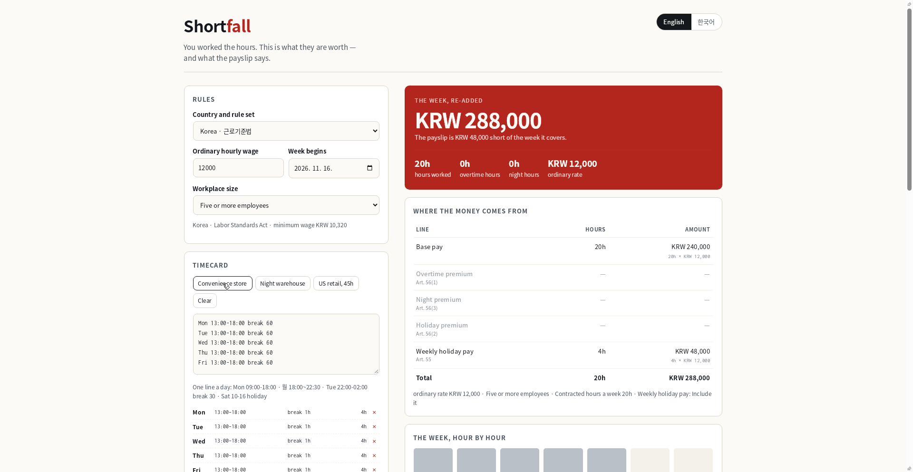

# Shortfall

[English (README.md)](./README.md)

**일한 시간은 그대로인데, 급여명세서에는 두 줄만 적혀 있습니다. 이 앱은 그 두 줄이 맞는지 다시 계산합니다.**

편의점에서 한 주 41시간을 일하고, 그중 4시간은 밤 10시 이후였는데 급여명세서에는 항목이 두 개뿐인 경우를 생각해 봅시다. 그 명세서만 봐서는 금액이 맞는지 알 수 없습니다. Shortfall은 근무시간과 적용 기준을 넣으면 한 주를 처음부터 다시 계산하고, 그 결과를 명세서 옆에 놓고 차액을 짚어 줍니다.

- **앱:** https://qkrrkdhzdl-arch.github.io/shortfall/
- **테스트:** https://qkrrkdhzdl-arch.github.io/shortfall/tests.html
- **시연 영상(2분 36초):** https://youtu.be/etIpHsM8ELw
- **Devpost:** https://devpost.com/software/shortfall



---

## 왜 만들었나

임금 체불은 대개 누군가 일부러 만든 계획이 아닙니다. 기억에 의존해 적은 근무시간, 야간 근무를 주간으로 잘못 적은 줄, 아르바이트라서 빠진 주휴수당, 통상시급으로 계산된 연장근로 수당처럼 사소한 실수에서 시작합니다. 근로자는 휴대폰에 근무표가 있고 손에 명세서가 있는데도 둘을 견줄 방법이 없습니다. 계산에 필요한 규칙을 외우고 다니는 사람은 없으니까요.

한국의 규칙은 구체적입니다. 연장근로 50% 가산, 야간근로(22시~06시) 50% 가산, 휴일근로는 8시간까지 50%·8시간 초과분 100% 가산, 주 15시간 이상이면 주휴수당, 2026년 최저임금은 10,320원입니다. 미국 연방 기준은 더 단순하면서 다릅니다. 주 40시간을 넘긴 시간에만 1.5배를 주고, 일 단위 연장도 야간 가산도 없습니다. 두 기준 모두 정확히 계산할 수 있지만, 실제로는 자주 틀립니다.

## 하는 일

1. **근무표를 사람이 적는 방식 그대로 읽습니다.** `Mon 09:00-18:00`, `월 18:00~22:30`, `Tue 22:00-02:00 break 30`, `Sat 10-16 holiday`, `11/17 9-6` 같은 표기를 알아듣습니다. `9-6`이 아홉 시부터 여섯 시까지라는 것, `22:00-02:00`이 자정을 넘어 이틀에 걸친다는 것, 휴게시간은 근로시간에서 빠진다는 것까지 반영합니다.
2. **근무 하나를 법이 다르게 계산하는 조각으로 나눕니다.** 기본, 연장, 야간(22시~06시), 휴일. 연장이면서 야간인 시간은 두 가산을 각각 계산합니다.
3. **선택한 기준으로 한 주를 더합니다.** 8시간을 넘는 일 단위 연장, 40시간을 넘는 주 단위 연장(두 번 세지 않음), 휴일근로의 두 구간, 계약 주 15시간 이상일 때의 주휴수당.
4. **모든 금액에 계산식을 붙입니다.** "연장수당 12,000원"이 아니라 `2시간 × 12,000원 × 50%`로 보여 줍니다. 계산기를 들고 직접 확인할 수 있습니다.
5. **명세서를 옆에 놓고 비교합니다.** `기본급 240,000`, `연장근로수당 90,000`, `Overtime (5h) $37.50`처럼 명세서에 적힌 대로 붙여 넣으면, 각 줄을 같은 항목으로 분류해 비교하고 차액을 말해 줍니다. 분류하지 못한 줄은 버리지 않고 따로 표시합니다.
6. **무엇을 전제했는지 밝힙니다.** 사업장 규모, 계약 근로시간, 주휴수당 적용 여부처럼 화면에서 볼 수 없는 사실은 묻습니다. 모든 요율에는 근거 조항이 붙습니다.
7. **바로 쓸 수 있는 것까지 만들어 줍니다.** 한 가지만 확인해 달라고 요청하는 중립적인 문구(비난도 협박도 없습니다), 계산 내역 CSV, 인쇄용 화면.

한국어와 영어를 지원합니다. 서버도 계정도 없고, 페이지를 연 뒤에는 네트워크 요청을 보내지 않습니다. 오프라인에서도 동작합니다.

## 일부러 하지 않는 것

- **법률 상담이 아닙니다.** 선택한 기준으로 계산한 결과일 뿐입니다.
- **이미지를 읽지 않습니다.** 근무표를 캡처한 사진은 읽지 않고, 텍스트만 읽습니다.
- **사실을 추정하지 않습니다.** 사업장 규모, 계약 형태, 휴게시간을 실제로 줬는지에 따라 답이 달라지므로 묻습니다. 상시 5인 미만이면 근로기준법 제56조 가산이 적용되지 않는다는 사실도 조용히 계산하지 않고 화면에 적습니다.
- **모든 경우를 다루지 않습니다.** 월급제, 탄력적 근로시간제, 포괄임금제, 미국 주 단위 연장법, 퇴직금은 범위 밖이며 화면에 그렇게 적습니다.

## 만든 방식

```
docs/
  index.html        화면
  app.js            상태, 렌더링, 내보내기 (프레임워크 없음)
  styles.css
  lib/time.js       시각·요일·날짜, 근무를 날짜와 야간 경계로 나누기
  lib/rules.js      한국(근로기준법)과 미국(FLSA) 기준 + computeWeek()
  lib/payslip.js    명세서 항목 분류와 비교
  tests.html        테스트를 페이지로 실행
  tests.js          162개 검증
tools/
  run_tests_qjs.py  브라우저 없이 내장 엔진으로 실행
  run_tests.py      Chromium에서 실행 (브라우저와 시스템 라이브러리 필요)
```

`computeWeek()`가 시간, 금액, 플래그를 반환하고 화면은 그것을 표시만 합니다. 그래서 같은 테스트를 페이지에서도, 내장 엔진에서도, 브라우저에서도 돌릴 수 있습니다.

### 실행

```
python3 tools/run_tests_qjs.py     # 162/162
python3 tools/run_tests.py         # 같은 테스트를 Chromium에서
python3 -m http.server -d docs 8000
```

## 확인한 것

시각 표기 해석(24시간제, 오전·오후, `24:00`), 요일과 날짜 해석, 모호한 구간(`9-6`, `12-6`, `18-2`, `22-2`), 세 가지 표기의 휴게시간, 자정을 넘는 근무 분할, 야간 구간, 중복 없이 계산한 일·주 단위 연장, 휴일근로 두 구간, 주휴수당과 15시간 기준, 5인 경계, 최저임금 경고, 미국의 주 단위 연장과 일·야간 가산의 부재, 두 언어의 명세서 항목 분류, 분류하지 못한 줄, 비교 결과까지 162개를 검증했습니다.

화면에 있는 세 가지 예시는 처음부터 끝까지 검증합니다. 20시간 편의점 근무(주휴수당 누락, 48,000원 부족), 41시간 야간 물류 근무(야간 가산 과소와 연장 1시간 미지급, 78,000원 부족), 45시간 미국 소매 근무(75달러 부족)입니다.

## 만든 대회

EvoHacks 2 (Devpost), 2026년 11월 21일~22일. 이 저장소의 모든 코드는 대회 기간에 작성했습니다.
