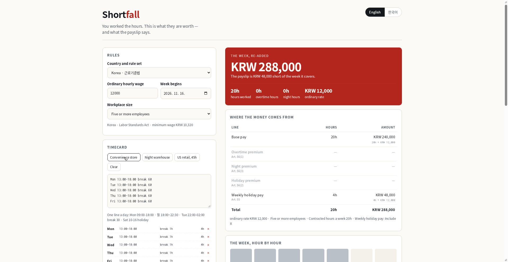

# Shortfall

[한국어 설명 (README.ko.md)](./README.ko.md)

**You worked the hours. This is what they are worth — and what the payslip says.**

A part-timer works forty-one hours, four of them after ten at night, and gets a payslip with two lines on it. Nothing on that payslip says whether the number is right. Shortfall takes the hours and the rules and re-adds the week, then puts the result next to the payslip and names the difference.

- **Live:** https://qkrrkdhzdl-arch.github.io/shortfall/
- **Tests:** https://qkrrkdhzdl-arch.github.io/shortfall/tests.html
- **Demo (2m36s):** https://youtu.be/etIpHsM8ELw
- **Devpost:** https://devpost.com/software/shortfall



---

## The situation

Wage underpayment is rarely a villain with a plan. It is a payslip built from the hours someone remembered, a night shift typed in as a day shift, a weekly holiday pay that was never added because the worker is part-time, an "overtime" line paid at the plain rate. The worker has the timecard in their phone and the payslip in their hand, and no way to put the two together: the arithmetic depends on rules nobody carries around.

In Korea those rules are specific — overtime +50%, night work (22:00–06:00) +50%, holiday work +50% up to eight hours and +100% beyond, weekly holiday pay for a week of fifteen hours or more, and a 2026 minimum wage of 10,320 KRW. In the United States the federal rule is simpler and different: overtime at 1.5× only after forty hours in a week, no daily overtime, no night premium. Both are exactly computable, and both are routinely got wrong.

## What it does

1. **Reads a timecard the way people write one.** `Mon 09:00-18:00`, `월 18:00~22:30`, `Tue 22:00-02:00 break 30`, `Sat 10-16 holiday`, `11/17 9-6`. It knows that `9-6` is nine to six in the evening, that `22:00-02:00` crosses midnight and belongs to two calendar days, and that the break comes off the paid hours.
2. **Splits every shift into the pieces the law pays differently.** Regular, overtime, night (22:00–06:00), holiday. A shift that is overtime *and* night has both premiums, and each is computed separately.
3. **Adds the week with the selected rule set.** Daily overtime beyond eight hours, weekly overtime beyond forty (counted once, never twice), holiday work's two tiers, weekly holiday pay for a contracted week of fifteen hours or more.
4. **Shows the formula behind every line.** Not "overtime: ₩12,000" but `2h × ₩12,000 × 50%`. The app never asks to be trusted; it can be checked with a calculator.
5. **Puts the payslip beside it.** Paste the payslip lines as they appear (`기본급 240,000`, `연장근로수당 90,000`, `Overtime (5h) $37.50`) and the app files each line into the same bucket, compares, and states the difference. Lines it cannot file are shown unread rather than dropped.
6. **States what it assumed.** Workplace size, contracted hours, whether weekly holiday pay applies — the facts the law turns on that the app cannot see. Each is a question on screen, and every rate carries the article it came from.
7. **Hands over something usable.** A neutral message asking the employer to check one thing (no accusation, no threats), a CSV of the calculation, and a printable page.

Korean and English. No server, no account, no network request after load. Works offline.

## What it deliberately does not do

- **It is not legal advice.** It is arithmetic on the rules you select.
- **It does not read images.** A screenshot of a timecard is not read; the text is.
- **It does not guess facts.** Workplace size, contract type and whether rest was actually given change the answer, so the app asks instead of assuming. Under five employees, art. 56 premiums do not apply and the app says so rather than quietly paying them.
- **It does not model everything.** Monthly salaried contracts, averaging schemes, fixed overtime allowances (포괄임금), state overtime laws in the US, and severance are out of scope and named as such on the page.

## How it is built

```
docs/
  index.html        the page
  app.js            state, rendering, exports (no framework)
  styles.css
  lib/time.js       clocks, weekdays, dates; splitting a shift across days and nights
  lib/rules.js      Korea (Labor Standards Act) and US (FLSA) rule sets + computeWeek()
  lib/payslip.js    payslip labels → buckets, and the comparison
  tests.html        the suite as a page
  tests.js          162 assertions
tools/
  run_tests_qjs.py  the suite without a browser (embedded engine)
  run_tests.py      the suite in Chromium (needs a browser with its system libraries)
```

`computeWeek()` returns hours, money and the flags; the page only formats it. That is why the same suite can run in a page, in an embedded engine, or in a browser.

### Run it

```
python3 tools/run_tests_qjs.py     # 162/162
python3 tools/run_tests.py         # same suite in Chromium
python3 -m http.server -d docs 8000
```

## What was checked

162 assertions across: clock parsing (24-hour, am/pm, Korean 오전/오후, `24:00`), weekday and date parsing, ambiguous spans (`9-6`, `12-6`, `18-2`, `22-2`), breaks in three notations, overnight splitting, night windows, daily and weekly overtime without double counting, holiday tiers, weekly holiday pay and its fifteen-hour floor, the five-employee boundary, minimum-wage flags, US weekly overtime and the absence of daily/night premiums, payslip label filing in both languages, unread lines, and the comparison itself.

The three scenarios on the page are asserted end to end: a 20-hour convenience-store week (the weekly holiday pay is missing → ₩48,000 short), a 41-hour night warehouse week (night premium underpaid and one overtime hour unpaid → ₩78,000 short), and a 45-hour US retail week ($75 short).

## Built for

EvoHacks 2 (Devpost), 21–22 November 2026. Everything here was written during the event.
